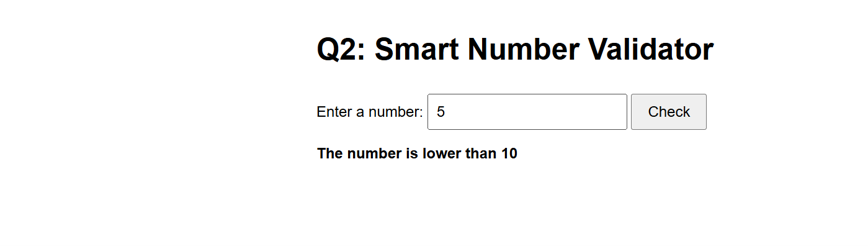
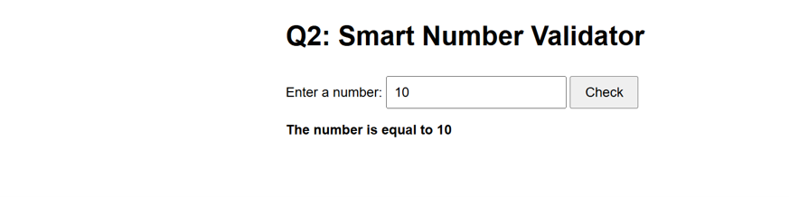
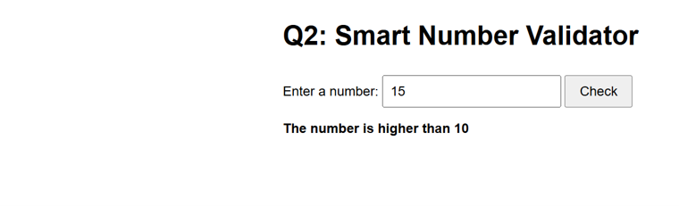
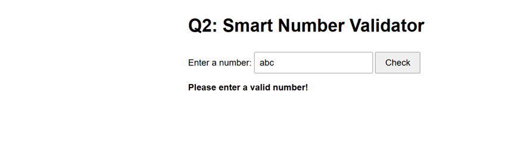
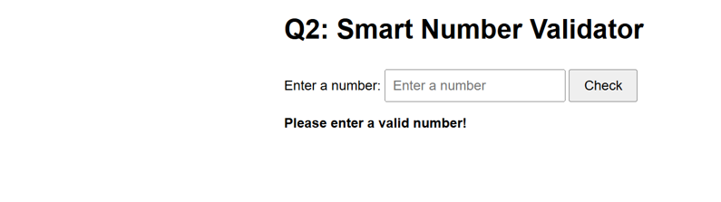
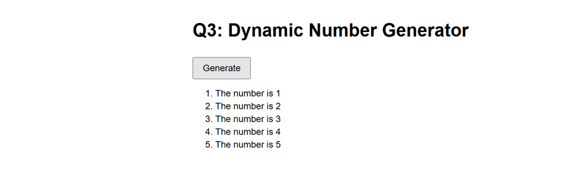

# BIC21203 Lab 4a – Client-Side Scripting (JavaScript)

**Name:** Muhammad Syawal Fanzury Bin Mohd Azri 
**Matric No.:** CI250115
**Course:** BIC21203 Web Development (Session 2026/2027)

## About

Three small interactive web pages built with HTML5 and plain JavaScript (no libraries).
Each question has its own folder with an `index.html` and an external `script.js` (loaded with `defer`).
All events use `addEventListener()` and all text updates use `textContent`.

| Folder | Question | What it does |
|--------|----------|--------------|
| `q1/` | Interactive Text Changer | `changeMessage()` changes the paragraph to "Hello there!" when the button is clicked |
| `q2/` | Smart Number Validator | `checkInput()` validates the input and says if the number is lower than, higher than or equal to 10 |
| `q3/` | Dynamic Number Generator | `generateNumbers()` uses a `for` loop and `createElement()` to build a list from 1 to 5, clearing old items first |

## How to Run

1. Clone the repository:
   ```bash
   git clone https://github.com/<your-username>/bic21203-lab4a-javascript.git
   ```
2. Open the folder in VS Code.
3. Right-click `q1/index.html` → **Open with Live Server** (or simply double-click the file to open it in a browser).
4. Repeat for `q2/index.html` and `q3/index.html`.

## Test Cases

**Q1:** Page loads with "Welcome to my website!" → click **Change Message** → shows "Hello there!".

**Q2:**

| Input | Expected output |
|-------|-----------------|
| 5 | The number is lower than 10 |
| 10 | The number is equal to 10 |
| 15 | The number is higher than 10 |
| 10.5 | The number is higher than 10 |
| abc | Please enter a valid number! |
| (empty) | Please enter a valid number! |

**Q3:** Click **Generate** → list shows "The number is 1" to "The number is 5". Clicking again does not duplicate the list.

## Screenshots

### Q1


### Q2






### Q3

